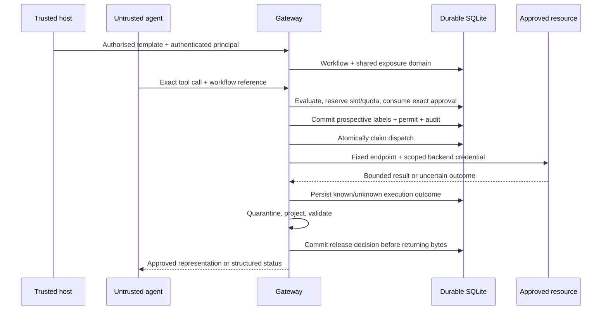

# Architecture and invariants

The implementation follows the narrow first-release path in Konstantin Grigorov's *Zero Trust Gateways for AI Agents* (v1.0, 29 October 2026), especially sections 5–9 and Appendix A. The paper is a design proposal; this code is a reference implementation with explicit omissions, not evidence that all proposed guarantees have been achieved.

| Module | Responsibility |
| --- | --- |
| `internal/core` | Versioned principal, manifest, workflow, candidate and decision contracts |
| `internal/config` | Strict operator config and exact-byte Ed25519 bundle verification |
| `internal/protocol` | Pinned protocol, JSON ambiguity rejection and application canonical encoding |
| `internal/policy` | Pure deterministic scope, entitlement, exposure and approval evaluation |
| `internal/workflow` | SQLite transactions, durable operation state, one-use approval, audit and reconciliation |
| `internal/executor` | Fixed endpoint and credential binding, bounded HTTP, authoritative status only |
| `internal/response` | Whole-object quarantine and approved representation generation |
| `internal/server` | Trusted host control, authenticated MCP surface and reviewer interface |

## Authority ordering

Hard denials precede approval. The accepted template, original workflow entitlements, currently authenticated entitlements, manifest resources/destination and shared exposure all constrain permission. A reviewer cannot add an unapproved tool, widen a resource or lower a label. Unknown effects and classification fail closed.

The candidate HMAC binds the principal, accepted contract, tenant exposure domain, logical operation and revision, complete manifest and canonical arguments, plus an effective policy digest covering the exact signed bundle digest and the operator authority map, including credential hashes. Changing a reviewer role, entitlement or credential invalidates pending authority on restart. JSON numbers preserve their lexical spelling conservatively: `1` and `1.0` receive different bindings. This is application canonical encoding, not RFC 8785 JCS. Only server-generated opaque operation identifiers are accepted for resumption. Writes and external effects require precreation through the authenticated control API so a lost reply cannot also lose the operation reference. Changed arguments require a new evaluated operation.

The server-held permit and owner epoch are recorded before a separate atomic dispatch claim. No agent-visible digest acts as a bearer execution permit. No adapter mutates arguments after approval. The HTTP executor checks that its captured manifest matches the operation manifest.

## Durable state

SQLite uses WAL, full synchronous writes and a transaction write lock acquired before reading shared authority. One tenant-wide domain holds confidentiality, untrusted integrity, a conservative cumulative call count and one unresolved execution slot. Fresh workflow creation joins its initial exposure into that domain; it cannot clear labels or quota. The shared count is deliberately stricter than per-workflow budgets and has no automatic reset.

Only metadata and HMAC bindings enter the audit chain; candidate arguments are held in the private state database. Responses, raw or projected, are not persisted. A completed request's replay returns status, never cached payloads or a second dispatch.

The coordinator does not hold database transactions across HTTP. It commits reservation and dispatch evidence first. A crash after claim is unresolved even if no request reached the resource. No lease expiry or restart creates redispatch authority. Reconciliation uses the resource's separately authorised status API; a missing receipt is **unknown**, not proof of failure.

Known resource success is distinct from response availability. Output schema failure leaves `SUCCEEDED` with `QUARANTINED`; it cannot undo a write. A release decision and label state are committed before any approved bytes are returned. If a process crashes after that commit but before delivery, payload replay is unavailable; an operator needs a separately authorised recovery action.

## Deployment limits

The SQLite profile is local, single-tenant and conservative; tests using separate database handles establish local atomic reservation behavior, not a distributed deployment. The implementation has no automatic credential exchange, remote attestation, tool sandbox, host egress controller or independent financial reconciliation. Signed local policy distribution protects exact bytes but does not implement an independently managed control plane. Audit events are the durable local outbox; automatic external checkpoint export is not implemented.
